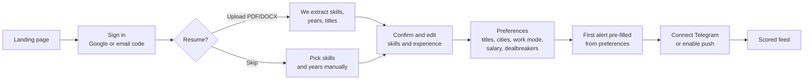
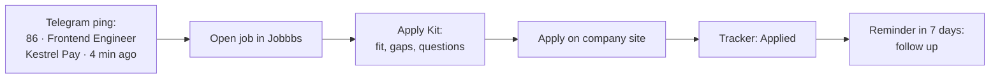
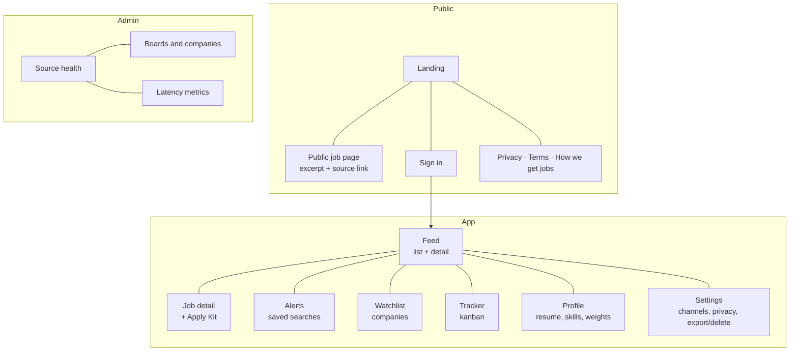

# Jobbbs — Product Requirements

| | |
|---|---|
| **Status** | Draft v1.0 — planning |
| **Date** | 22 Oct 2026 |
| **Supersedes** | `JobRadar_Project_Requirements_and_Implementation_Plan.docx` (raw notes) |
| **Related** | [System design](02-system-design.md) · [Tech stack](03-tech-stack-and-deployment.md) · [Data sources](04-data-sources-and-compliance.md) · [Design system](05-design-system.md) · [Roadmap](06-roadmap.md) |

---

## 1. The problem

When you open a job on LinkedIn or Naukri it already says "200+ applicants". You lost the race before you started. Three things cause it:

1. **You see jobs late.** Platform alerts are batched (daily or weekly emails), and feeds are ranked rather than ordered by time.
2. **Everyone sees the same listing at the same moment.** The crowd forms on the big boards.
3. **Deciding takes too long.** Filters are coarse, there is no explanation of fit, and the details you need to apply are spread across pages.

## 2. The insight that makes Jobbbs possible

Most tech companies publish a job **first on their own Applicant Tracking System (ATS)**, such as Greenhouse, Lever, Ashby, Workable or SmartRecruiters. The listing reaches LinkedIn, Naukri, Indeed and the aggregators after that, by syndication, re-posting or a recruiter copying it, and that is where the applicant crowd forms.

Many ATS platforms publish each company's board as **public JSON built for careers pages**. If we watch those boards directly and alert within minutes, a user can apply on the company's own site before the listing has spread.

> **Hypothesis H1 (measured in Phase 1):** for companies on public ATS boards, Jobbbs detects a new job within 15 minutes of it being published at the source (median). We will measure `first_seen_at − posted_at` per source and publish the real number on the landing page. We do not claim it before we have measured it.

## 3. Product definition

**Jobbbs is a personal job radar.** It watches company career boards and job feeds, scores every new job against your profile, alerts you within minutes, and gives you everything you need to apply first.

- It is **not** a job board. We don't host postings; we point to the original.
- It is **not** an auto-apply bot. The user applies themselves, on the employer's site.
- It is **not** a LinkedIn or Naukri scraper. See [data sources](04-data-sources-and-compliance.md).

**Tagline:** *Jobs, the minute they go live.*

**Core loop:** Detect → Score → Alert → Apply → Track.

### Release plan (decided 22 Oct 2026, ADR-013)

| Release | Users | Alerts | Scope |
|---|---|---|---|
| **Personal edition (v1)** | The owner only; sign-ups closed | **Email to the owner** (Resend test sender, no domain) | F1–F8, F10–F15 |
| **Public edition** | Invited users, then open | Telegram, Web Push, email from own domain | Adds onboarding wizard, landing and public pages, F16 data rights, legal pages |

The personas below describe the public edition. In v1 the owner is the only user and plays all three roles.

## 4. Who it's for

| Persona | Situation | What they need from Jobbbs |
|---|---|---|
| **Aarav, early-career developer** (0–3 yrs, Pune/Bengaluru) | Applies to 15–30 jobs a week, mostly via LinkedIn and Naukri, and keeps seeing "200+ applicants". | Volume plus speed: instant alerts for matching roles, quick "Apply first" triage. |
| **Meera, senior engineer** (6–9 yrs, Hyderabad) | Selective. Has a list of about 25 target companies and checks their career pages by hand. | A **company watchlist**: a ping the minute a target company opens a role that fits. |
| **Kabir, remote-first** (4 yrs, Indore) | Wants remote roles open to India, paid in USD or EUR. | Remote filters that are actually reliable ("Remote — India eligible"), salary in the posted currency. |
| **Admin (you)** | Runs the platform. | Source health, company and board management, detection-latency metrics. |

**Launch market:** India-based job seekers in **tech roles** (software, data, design, product, DevOps/SRE, QA), plus remote roles open to India. See decision **D2** in the [decision log](08-decision-log.md).

## 5. Goals and non-goals

### Goals (first 12 months)

| ID | Goal | Measure |
|---|---|---|
| G1 | Be early | Median detection latency under 15 min for ATS sources (H1) |
| G2 | Be relevant | At least 70% of alerts rated relevant (thumbs-up rate) |
| G3 | Drive action | 30% or more of saved jobs are marked "Applied" within 24 h |
| G4 | Stay cheap | ₹0 infrastructure until about 600 users; under ₹2,000/month at 5,000 users |
| G5 | Earn trust | Every score is explained; every job links to its original source; no invented numbers |

### Non-goals

- Automatic applications or browser automation on third-party sites.
- Scraping pages behind a login, or scraping LinkedIn, Naukri or Indeed.
- Showing applicant counts (we can't know them, so we never show or estimate them).
- A recruiter or employer product (maybe later; not in scope).
- A resume builder (Apply Kit gives keyword hints, not rewrites).

## 6. Features and priorities

Priority uses MoSCoW: **M**ust, **S**hould, **C**ould, **W**on't (for now). The phase number refers to the [roadmap](06-roadmap.md).

| ID | Feature | What it does | Priority | Phase |
|---|---|---|---|---|
| F1 | Live job feed | Unified, de-duplicated feed with source attribution and the original apply link. | M | 2 |
| F2 | Search, filters and sorting | Keywords, title, skills, location, work mode, experience, salary, company, source, "detected within", employment type. Sorts: *Best match*, *Newest*, *Apply first*. | M | 2 |
| F3 | Freshness signals | "Detected 7 min ago", "Posted at source 10:35 IST", "Reposted 2×", "Also listed on Adzuna". | M | 1–2 |
| F4 | Profile and resume parsing | Upload a PDF or DOCX; we extract skills, years, titles and education; the user confirms and edits. | M | 3 |
| F5 | Match score (0–100) | Weighted, explainable score with breakdown, matched and missing skills, and a confidence level. | M | 3 |
| F6 | Weights and dealbreakers | Sliders for score weights; hard filters ("never onsite", "exclude these companies"). | S | 3 |
| F7 | Saved searches and alerts | Instant, hourly, daily or weekly; minimum score; quiet hours. | M | 4 |
| F8 | Company watchlist | Follow companies; get alerted on any role from them that matches you. | M | 4 |
| F9 | Alert channels | v1: **email to the owner** (instant, bundled within 5 min). Public edition: **Telegram bot** and **Web Push** (instant), email digests. | M | 4 / Go public |
| F10 | Apply Kit | Role summary, must-haves vs nice-to-haves, your gaps, resume keywords, the application's questions (where the source provides them), referral search links, direct ATS link. AI-written parts are optional. | M (rules) / S (AI) | 5 |
| F11 | Smart Links | One-click searches on LinkedIn, Naukri, Indeed, Wellfound and others, pre-filtered to "last hour" for each saved search. | M | 5 |
| F12 | Application tracker | Kanban: Saved → Applying → Applied → Interviewing → Offer / Rejected, with notes and follow-up reminders. | M | 5 |
| F13 | Keyboard-first triage | `j`/`k` to move, `s` to save, `a` to apply, `x` to hide, `/` to search. | S | 2 |
| F14 | Relevance feedback | Thumbs up/down on alerts and feed items, with an optional reason. Feeds tuning. | S | 4 |
| F15 | Admin console | Source health, board manager, ATS detector, latency metrics. | M | 1 |
| F16 | Account controls | Export my data, delete my account, notification preferences. | M | Go public |
| F17 | Alert-email forwarding | Forward LinkedIn, Naukri or Indeed alert emails to a personal Jobbbs address; we parse, score and merge them. | C | 7 |
| F18 | Company pages | Open roles, hiring velocity ("12 new roles in 30 days"), board link. | C | 7 |
| F19 | "Send to Jobbbs" browser button | User-initiated: send the job page you're viewing to Jobbbs for a score and Apply Kit. | C | 7+ |
| F20 | WhatsApp alerts | Paid channel (Meta charges per message). | W | later |
| F21 | Auto-apply | Out of scope by principle. | W | — |

## 7. User stories and acceptance criteria

**US-01 — See new jobs early**
*As a job seeker, I want to see jobs within minutes of a company publishing them, so I can apply before the crowd.*
- Given a company on a Tier-A board publishes a job, when the next poll runs, then the job appears in the feed with "Detected N min ago".
- Each job shows **two separate times**: when the source says it was posted (if known) and when Jobbbs first saw it. We never present our detection time as the posting time.

**US-02 — Filter precisely**
*As a job seeker, I want to combine filters (for example: React, Bengaluru or Remote, 2–4 yrs, ₹15L+, last 24 h) so I only see jobs I would apply to.*
- Every filter combination returns correct results (covered by tests in the [roadmap](06-roadmap.md)).
- Unknown values (for example, no salary listed) are included by default, with a toggle "Hide jobs without salary".

**US-03 — Understand the score**
*As a job seeker, I want to know why a job scored 86, so I can trust it.*
- The breakdown lists each factor, its weight, its points, and a reason in plain words ("You have 5 of 6 required skills; missing: Kubernetes").
- When data is missing, the factor reads "Unknown". It is excluded from the score and lowers the confidence; it is not treated as a mismatch.

**US-04 — Get alerted instantly**
*As a job seeker, I want a message when a new matching job appears: email in the personal edition; Telegram or push in the public edition.*
- Telegram/push alerts arrive within 2 minutes of detection (p95). Email alerts arrive within 5 minutes (p95), because matches found close together are bundled into one email.
- The same job never alerts the same person twice on the same channel.
- Quiet hours hold alerts and deliver them in one bundle afterwards.

**US-05 — Watch target companies**
*As a senior engineer, I want to follow 25 companies and hear about any role that fits me.*
- Following a company that isn't monitored yet starts monitoring after admin approval (or automatically, if the ATS is detected).
- Watched companies get a score bonus and can bypass the minimum score if the user opts in.

**US-06 — Apply with confidence**
*As a job seeker, I want the key information for applying on one screen.*
- The rule-based Apply Kit shows in under 1 second; the optional AI section streams in under 15 seconds.
- The "Apply" button goes to the original application page and records "Applying" in the tracker.

**US-07 — Check other platforms quickly**
*As a job seeker, I want one click to see the last hour's jobs for my search on LinkedIn and Naukri.*
- Each saved search shows Smart Links that open the platform's own search with my keywords, location and a recent-only filter.

**US-08 — Track applications**
*As a job seeker, I want to see where every application stands and be reminded to follow up.*
- Moving a card to "Applied" sets a default 7-day follow-up reminder, sent through the user's preferred channel.

**US-09 — Control my data**
*As a user, I want to download or delete everything Jobbbs knows about me.*
- Export gives JSON of the profile, skills, searches and tracker. Delete removes the account, resume file and personal rows within 24 hours.

**US-10 — Operate the system (admin)**
*As the admin, I want to see which sources are failing and how fresh our detection is.*
- The dashboard shows, per source: polls in the last 24 h, success %, last error, p50/p95 detection latency, and new jobs per day.

## 8. Key journeys

### Onboarding (target: under 3 minutes to first scored feed)

### Daily use

## 9. Screens

## 10. Non-functional requirements

| Area | Requirement |
|---|---|
| Freshness | Tier-A boards polled at least every 10 min; detection p50 under 15 min (H1) |
| Alert latency | Under 2 min from detection to delivery (p95) for instant channels |
| Performance | Feed server response under 400 ms (p75, India); LCP under 2.5 s on mid-range Android over 4G |
| Availability | Best effort 99% for web; ingestion failures in one source never stop other sources |
| Cost | ₹0/month at up to about 600 users (see [tech stack](03-tech-stack-and-deployment.md) §3) |
| Security | Row-Level Security on every user table; secrets server-side only; private resume storage |
| Privacy | Built to India's DPDP Act 2023 / DPDP Rules 2025 (notice, consent, deletion, grievance contact) |
| Accessibility | WCAG 2.2 AA; full keyboard use; never color-only meaning |
| Honesty | No invented applicant counts, posting dates, testimonials or statistics, anywhere |

## 11. Success metrics

- **North star:** *Applications started within 2 hours of detection, per weekly active user.* It captures speed, relevance and action together.
- **Supporting metrics:** detection latency p50/p95 per source; alert latency p95; alert thumbs-up rate; alert click-through rate; D7 and D30 retention; jobs covered (active) and companies watched; source success rate.

## 12. Assumptions to validate

| ID | Assumption | How we test it | When |
|---|---|---|---|
| H1 | ATS boards give us jobs earlier than the big platforms | Measure detection latency; spot-check 50 jobs against LinkedIn's "posted X ago" by hand | Phase 1 |
| H2 | Enough Indian tech employers use public-board ATSs to make the feed worthwhile | Run the ATS detector over a seed list of 500 Indian tech companies; target 40% or more detected | Phase 0–1 |
| H3 | Users trust a rule-based score | Thumbs-up rate of 70% or more on alerts | Phase 4 alpha |
| H4 | Telegram is an acceptable alert channel for Indian job seekers | Channel opt-in rates in alpha | Phase 4 |
| H5 | The rule-based Apply Kit alone is useful | Usage of the kit vs. AI section | Phase 5 |

## 13. What changed from the raw document

| Raw doc (JobRadar) | This plan (Jobbbs) | Why |
|---|---|---|
| Name JobRadar | **Jobbbs** | Your choice. |
| "Integrate with LinkedIn, Naukri, Indeed" via APIs | **Source-first:** watch company ATS boards directly; Smart Links and alert-email forwarding for the big platforms | Those platforms don't offer open job-search APIs, and scraping them breaks their terms. ATS-direct is also *faster*, which is the whole point. |
| Cloudflare Workers *or* Vercel *or* GitHub Actions for background jobs | **Supabase Cron + Edge Functions + Queues** | Vercel Hobby cron runs only once a day; Cloudflare free has a 10 ms CPU and 50-subrequest limit; GitHub Actions schedules drift and aren't meant as production schedulers. Supabase runs every minute, close to the data. |
| Email alerts (Resend) as the main channel | Personal edition: **email to yourself**, no domain needed. Public edition: **Telegram + Web Push** primary, email for digests | With one recipient, Resend's free tier is plenty. With many users, its 3,000 emails/month is the first free limit we'd hit, while Telegram and push are free and instant. |
| Generic weights, unknowns "not a mismatch" | Same principle, now formalized: unknown factors are excluded and lower a **confidence** value; separate **Apply-first priority** combines fit and freshness | Gives a sort order that matches the product promise. |
| 2–4 week MVP | **About 9.5 weeks to personal v1** (part-time, solo with Claude Code); public edition later | Ingestion, de-duplication and alerting are the hard parts and need soak time. |
| Generic UI (shadcn defaults) | Distinct, information-dense design system ([05](05-design-system.md)) | You asked for a site that looks professional rather than AI-made. |
