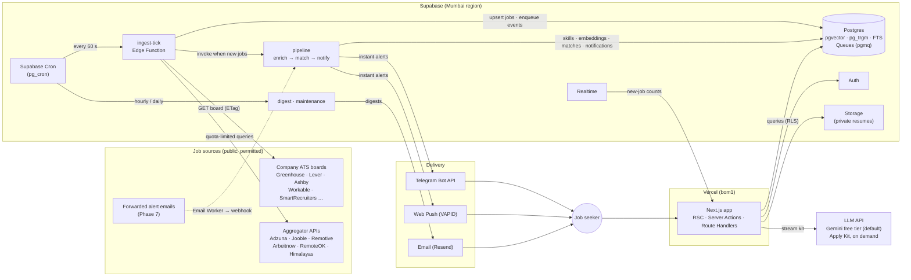
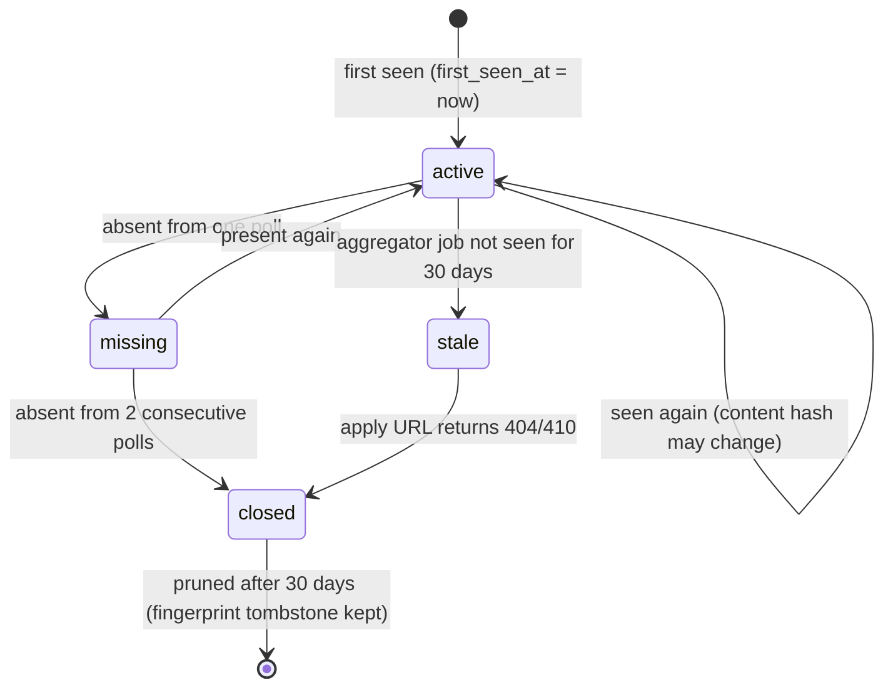
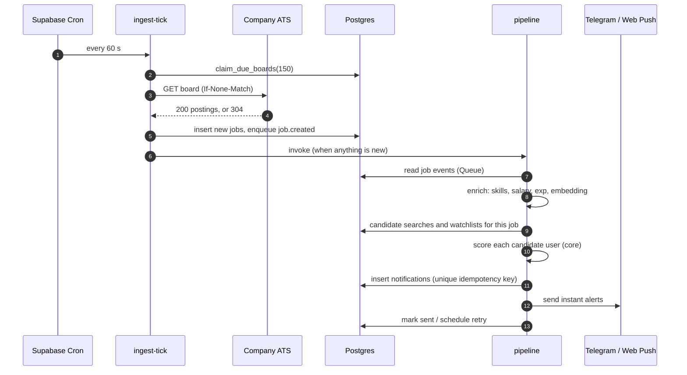
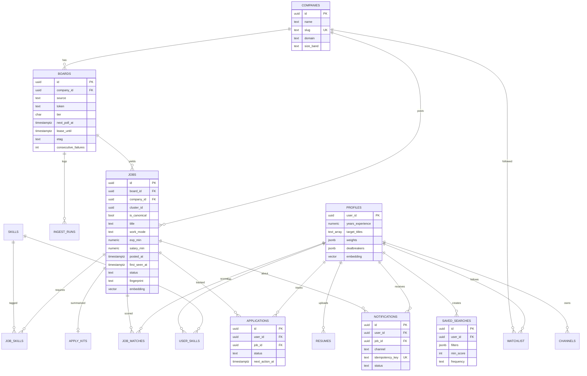

# Jobbbs — System Design

| | |
|---|---|
| **Status** | Draft v1.0 — planning |
| **Date** | 22 Oct 2026 |
| **Related** | [PRD](01-product-requirements.md) · [Tech stack](03-tech-stack-and-deployment.md) · [Data sources](04-data-sources-and-compliance.md) · [Decision log](08-decision-log.md) |

---

## 1. Architecture at a glance

Jobbbs has two halves that share one Postgres database:

- **The engine** runs on a schedule with no browser involved. It polls sources, normalizes and de-duplicates jobs, enriches them, matches them to users and sends alerts.
- **The app** is a Next.js site where people browse the feed, read scores, manage alerts and track applications.

> **Personal edition (v1, ADR-013/014):** the diagram shows the target design. In v1 the only delivery channel is **email to the owner** through Resend's test sender, and Telegram/Web Push wait for the Go-public phase. Everything else is built as shown.



### Component responsibilities

| Component | Runs on | Responsibility |
|---|---|---|
| **Next.js app** (`apps/web`) | Vercel, Mumbai (`bom1`) | Public pages, authenticated app, admin console, Apply Kit streaming, Telegram/push sign-up flows |
| **Core library** (`packages/core`) | Imported by both web and Edge Functions | Pure TypeScript: source adapters, normalizers, de-duplication, skill extraction, scoring. **No I/O and no runtime-specific APIs**, so it runs unchanged in Node and Deno. |
| **ingest-tick** | Supabase Edge Function, Supabase Cron every 60 s | Claims due boards, fetches, normalizes, upserts, detects closed jobs, records metrics |
| **pipeline** | Edge Function, invoked by ingest-tick, plus a sweeper every 2 min | Enrich (skills, experience, salary, embedding) → match (saved searches and watchlists) → create notifications → send instant alerts |
| **digest** | Edge Function, hourly | Bundles hourly, daily and weekly digests per user → email |
| **maintenance** | Edge Function, daily 03:00 IST | Closes stale jobs, prunes old rows, re-tiers boards, checks DB size, sends heartbeat |
| **telegram-webhook** | Edge Function (HTTP) | `/start <token>` links a chat to an account; `/pause`, `/resume`, `/stop` |
| **Postgres** | Supabase | System of record. Full-text search, trigram, pgvector, Queues (pgmq), RLS. |

---

## 2. Ingestion engine

### 2.1 Scheduling: tiers and leases

Each polled endpoint is a row in `boards` (one company's ATS board, or one aggregator query). Every board has a **tier** that sets how often it's polled:

| Tier | Interval | Who's in it | Example count | Polls/day |
|---|---|---|---|---|
| **A** | 10 min | Companies on any user's watchlist, or posting at least 4 jobs a week | 300 | 43,200 |
| **B** | 30 min | Active companies | 700 | 33,600 |
| **C** | 3 h | Low-activity companies | 500 | 4,000 |
| **Q** | per quota | Aggregator queries (Adzuna, Jooble …) | ~25 queries | ~30 |
| | | | **≈1,500 boards** | **≈81,000** |

That's about **56 boards per minute**. Each ingest-tick claims up to 150 due boards, so there is room to grow roughly 2.5× before we need more ticks.

**Claiming work safely.** Overlapping ticks must never poll the same board twice. A SQL function hands out leases:

```sql
-- Returns up to p_limit boards that are due, leased for 2 minutes.
create or replace function claim_due_boards(p_limit int)
returns setof boards language sql as $$
  update boards b
     set lease_until = now() + interval '2 minutes'
   where b.id in (
     select id from boards
      where enabled
        and next_poll_at <= now()
        and (lease_until is null or lease_until < now())
      order by tier, next_poll_at
      limit p_limit
      for update skip locked)
  returning b.*;
$$;
```

After a poll, `next_poll_at = now() + tier_interval + jitter(±10%)`. On failure we back off exponentially: `min(interval × 2^failures, 6 h)`.

### 2.2 The adapter contract

Every source implements one interface in `packages/core`. Adapters receive a `fetch` function from the runtime, so they stay pure and testable with recorded fixtures.

```ts
export type SourceId =
  | 'greenhouse' | 'lever' | 'ashby' | 'workable' | 'smartrecruiters' | 'recruitee'
  | 'adzuna' | 'jooble' | 'remotive' | 'arbeitnow' | 'remoteok' | 'himalayas';

export interface PollTarget {
  boardId: string;
  source: SourceId;
  token: string;               // ATS board token, or aggregator query key
  companyId: string | null;
  etag?: string | null;
}

export interface FetchContext {
  fetch: typeof fetch;         // injected; adds User-Agent, timeout, per-host rate limit
  now: () => Date;
  log: (event: string, data?: Record<string, unknown>) => void;
}

export type ListResult =
  | { status: 'ok'; postings: RawPosting[]; etag?: string | null }
  | { status: 'not_modified' }
  | { status: 'error'; httpStatus?: number; retryAfterSec?: number; message: string };

export interface SourceAdapter {
  id: SourceId;
  kind: 'ats' | 'aggregator';
  /** All currently open postings for the target (ATS), or the latest page (aggregator). */
  list(target: PollTarget, ctx: FetchContext): Promise<ListResult>;
  /** Optional detail fetch for new postings when the list is shallow (e.g. Greenhouse without content). */
  detail?(posting: RawPosting, target: PollTarget, ctx: FetchContext): Promise<RawPosting>;
  /** Pure mapping. Throws a ZodError if the payload shape changed. */
  normalize(raw: RawPosting, target: PollTarget): NormalizedJob;
}
```

### 2.3 Normalized job model

This improves on the raw doc's `Job` type: it adds multi-location, currency period, seniority, a fingerprint, and separate timestamps.

```ts
export interface NormalizedJob {
  source: SourceId;
  externalId: string;
  companyName: string;
  title: string;
  titleNorm: string;                  // lowercased, codes/brackets stripped
  seniority: 'intern' | 'junior' | 'mid' | 'senior' | 'lead' | 'manager' | 'unknown';
  department: string | null;
  descriptionText: string;            // HTML → text, max 20k chars
  locations: { city?: string; region?: string; country?: string }[];
  countryCodes: string[];             // ISO-3166 alpha-2, e.g. ['IN']
  workMode: 'remote' | 'hybrid' | 'onsite' | 'unknown';
  remoteEligibility: string[] | null; // e.g. ['IN', 'APAC'] when stated
  employmentType: 'full_time' | 'part_time' | 'contract' | 'internship' | 'unknown';
  experience: { min: number | null; max: number | null };   // years
  salary: {
    min: number | null; max: number | null;
    currency: string | null;          // 'INR', 'USD' …
    period: 'year' | 'month' | 'hour' | null;
    isEstimate: boolean;              // true when the source predicted it (e.g. Adzuna)
  };
  applyUrl: string;                   // the original application page
  sourceUrl: string;                  // the original listing
  postedAt: string | null;            // as stated by the source, ISO UTC; null if unknown
  raw?: unknown;                      // kept in memory only, never stored
}
```

India-specific parsing gets its own tested module: "₹12–18 LPA", "12-18 Lacs", "INR 1,20,000/month", "3-5 Yrs", "Bengaluru/Bangalore/BLR", "Gurgaon/Gurugram", "Remote (India)".

### 2.4 Write-light polling

Writing to every job on every poll would bloat Postgres. At 81k polls/day and around 30 jobs each, that's about 2.4M row updates a day, too many for a free-tier database. So:

1. Fetch the board. On `304 Not Modified` (ETag), we're done.
2. Load the set of `external_id`s currently **active** for that board (indexed, cheap).
3. **New IDs** → fetch detail if needed → normalize → insert → enqueue `job.created`.
4. **Existing IDs** → compare a `content_hash` (title + location + description hash). Update only if it changed → enqueue `job.updated`.
5. **Missing IDs** → `missing_since = now()` on the first miss. Close the job on the second consecutive miss.
6. `last_seen_at` on jobs is refreshed at most once every 6 hours; per-poll freshness lives on the board row.

### 2.5 Job lifecycle



A **repost** is a new posting whose fingerprint matches a tombstone or a closed job from the last 90 days. We show it as "Reposted 2×". Reposts can signal a hard-to-fill role, or a ghost job.

### 2.6 De-duplication

The same job can arrive from the company's ATS **and** from an aggregator. We cluster them:

1. **Exact:** same `(source, external_id)` → same row (upsert).
2. **Fingerprint:** `sha1(company_norm | title_norm | primary_city_or_remote)`. The company is normalized by stripping "Pvt Ltd", "Private Limited", "Inc", "Technologies" and similar suffixes, plus domain matching where available.
3. **Fuzzy:** same company, `similarity(title_norm) > 0.85` (pg_trgm), and posted within 14 days of each other.

Each cluster has one **canonical** job. We prefer the ATS-direct source because its apply URL is on the employer's domain. The other members become "Also listed on …" chips. The feed shows canonical jobs only.

### 2.7 Enrichment

Done in the `pipeline` function for every `job.created` or `job.updated` event:

| Step | Method | Cost |
|---|---|---|
| Skills | Dictionary match against `skills` (canonical name + aliases), section-aware: words under "Requirements/Must have" become *required*, under "Nice to have/Bonus" become *preferred* | Free, deterministic |
| Experience | Regex patterns ("3+ years", "3-5 yrs", "minimum 2 years") | Free |
| Salary | Parser (§2.3), unless the source gives structured salary | Free |
| Seniority | Title keywords + experience range | Free |
| Embedding | Supabase's built-in `gte-small` model (384 dimensions) on `title + top skills + first 1,500 chars` | Free (CPU only) |
| AI extraction | **Not** done for every job. Only on demand inside the Apply Kit (§5). | Paid, per use |

---

## 3. Matching and scoring

### 3.1 Principles

- Scoring is **deterministic TypeScript** in `packages/core/scoring`, so the same code runs in the feed (web) and in alerts (Edge Function).
- **Unknown is not zero.** A factor with no data is left out of the weighted average and lowers **confidence** instead.
- **Dealbreakers are filters, not scores.** A job that breaks one is hidden, not scored 0.
- The score measures **fit against your stated preferences**. It is never presented as a chance of being hired.

### 3.2 The formula

For each factor *i* with weight *wᵢ* (they sum to 100) and sub-score *sᵢ* ∈ [0, 1] or *unknown*:

```
Match      = round( 100 × Σ(wᵢ·sᵢ for known i) / Σ(wᵢ for known i) )
Confidence = Σ(wᵢ for known i) / 100          → shown as High (≥0.8), Medium (≥0.6), Low
```

| Factor | Default weight | Sub-score sᵢ |
|---|---|---|
| **Skills** | 35 | `0.8 × required_coverage + 0.2 × preferred_coverage`. A skill counts when it matches by canonical ID or alias. A related skill (e.g. Next.js when React is required) counts 0.5. If the job has no extracted skills, we fall back to embedding similarity between profile and job (mapped 0.55→0, 0.85→1). |
| **Experience** | 20 | In range → 1. Below min: `max(0, 1 − (min − yrs) × 0.5)`. Above max: `max(0.5, 1 − (yrs − max) × 0.1)`. Unknown if the job states nothing. |
| **Role fit** | 15 | Best cosine similarity between the job title and the user's target titles (mapped 0.6→0, 0.9→1), × seniority alignment (1 / 0.7 / 0.4 for same / adjacent / far). |
| **Location and work mode** | 10 | Remote wanted and job remote-eligible for the user's country → 1; city match → 1; same country and user willing to relocate → 0.6; else 0. |
| **Salary** | 10 | Overlap of the job's range with the user's minimum. Fully above → 1; partly → proportional; below → 0. Unknown if not listed. Predicted salaries count at half weight. |
| **Preferences** | 10 | Watchlist company (+), preferred company size or industry, employment type, visa needs. |

**Example.** A user with 3 years of React/TypeScript/Node, who wants Bengaluru or remote and ₹18L+, sees a "Frontend Engineer" role needing React, TypeScript and GraphQL, 2–4 yrs, Bengaluru hybrid, salary not listed:

| Factor | Weight | sᵢ | Points |
|---|---|---|---|
| Skills | 35 | 0.8×(2/3) + 0.2×1 = 0.73 | 25.7 |
| Experience | 20 | 1.0 | 20.0 |
| Role fit | 15 | 0.9 | 13.5 |
| Location/mode | 10 | 1.0 | 10.0 |
| Salary | 10 | *unknown* | — |
| Preferences | 10 | 0.5 | 5.0 |
| **Total** | known weight 90 | | 74.2 / 90 → **Match 82**, **Confidence High (0.9)** |

### 3.3 Priority ("Apply first")

The feed's *Apply first* sort combines fit with freshness, because a strong match that's 3 hours old beats a perfect match that's 4 days old:

```
age_h    = hours since first_seen_at
Priority = Match × (0.35 + 0.65 × e^(−age_h / 12))
```

### 3.4 Weights, dealbreakers and feedback

- Users can adjust weights with sliders (they always sum to 100). Defaults ship with the scorer version (`scorer_version`), so scores can be recomputed after changes.
- Dealbreakers: excluded companies, excluded keywords, work modes, minimum salary (strict), maximum experience required.
- Thumbs up/down with an optional reason ("wrong seniority", "not my stack", "location") are stored in `match_feedback`. Phase 7 uses this to suggest weight changes. Silent auto-tuning is avoided because users should understand their own scores.

---

## 4. Alerts and notifications

### 4.1 Flow



### 4.2 Finding who to alert, cheaply

Scoring every user for every new job doesn't scale. Instead:

1. **SQL prefilter** finds the candidate saved searches for a new job: active, work-mode compatible, country/city compatible, experience compatible, and `job.search @@ saved_search.tsquery` when the search has keywords. Watchlist followers of the company are added.
2. **Score** only those candidates in TypeScript.
3. If `score ≥ saved_search.min_score` (or watchlist override) → create one notification per enabled channel.

### 4.3 Exactly-once delivery

- `notifications.idempotency_key = sha256(user_id | job_cluster_id | channel)` has a **unique** constraint. Inserts use `ON CONFLICT DO NOTHING`, so retries and duplicate events can never double-alert. Keying on the cluster means the same job from two sources alerts once.
- The sender marks `sent_at` only after the provider accepts. On failure: retry at 1, 5 and 30 minutes, then mark `failed`.
- Telegram `403 Forbidden` (the user blocked the bot) disables that channel and shows a banner in the app.

### 4.4 Frequency, quiet hours, digests

| Frequency | Behavior |
|---|---|
| Instant | Telegram/push within ~1 min of detection. During quiet hours it's held and sent as one bundle when they end. |
| Hourly / Daily / Weekly | Accumulated, then one message per period via the `digest` function. Email defaults to weekly. |

Rate limits we respect: Telegram allows about 30 messages/second overall and about 1/second per chat. Resend's free plan allows 100 emails/day and 3,000/month, so email is digests only (see [tech stack](03-tech-stack-and-deployment.md) §3).

### 4.5 Personal edition: email to the owner

| Rule | Value |
|---|---|
| Sender → recipient | `onboarding@resend.dev` → `ALERT_EMAIL_TO` (must be the email on your Resend account; anything else gets a 403) |
| When to send | As soon as `pipeline` finds a match at or above the saved search's minimum score |
| Bundling | Matches found within 5 minutes of the previous email are held and sent together in the next one |
| Daily cap | 80 emails/day (Resend free: 100/day, 3,000/month). Beyond that, alerts roll into one hourly digest until midnight IST |
| Quiet hours | Held and sent as one bundle when quiet hours end |
| Subject | `3 new · 86 Frontend Engineer · Kestrel Pay` (top match first) |
| Body | Per job: score, title, company, location/mode, salary if listed, "detected 4 min ago", **Apply on company site**, **Open in Jobbbs**, thumbs up/down links; footer with Smart Links for the search |
| Idempotency | Same `notifications` key as §4.3, with channel `email` |

On the phone: a Gmail filter on the sender ("Never send to spam", "Mark as important", label "Jobbbs") with notifications on for that label.

### 4.6 Live feed updates

Supabase Realtime broadcasts a lightweight event, "N new jobs match your filters", to signed-in users. The UI shows a banner ("3 new · Show") and doesn't reorder the list under the user's cursor.

---

## 5. Apply Kit

| Section | Source | Available |
|---|---|---|
| At a glance: title, company, location, mode, salary (stated / predicted / not listed), experience | Job record | Always |
| Your fit: matched skills, missing skills, score breakdown | Scoring | Always |
| Must-haves vs nice-to-haves | Section-aware skill extraction | Always |
| Resume keywords: important JD terms missing from your resume | Term-frequency diff | Always |
| Application questions (e.g. notice period, work authorization) | Greenhouse `?questions=true` and similar, where the source exposes them | Some sources |
| Referral and recruiter search links | Generated LinkedIn people-search URLs ("<company> recruiter", "<company> engineering manager") | Always |
| Timeline: posted at source, detected by Jobbbs, reposted N× | Job record | Always |
| **AI section:** 3-line role summary, interview topics to prepare, tailored cover note draft | LLM via `LlmProvider` (Gemini free tier by default, ADR-016), on demand, streamed | When enabled |

**AI cost and privacy control**

- Job-level parts (summary, topics) are generated **once per job** and cached in `apply_kits`, so the cost is shared across users.
- User-level parts (the cover note) are generated only on click and cached per `(user, job)`.
- A daily request limit (`AI_DAILY_REQUEST_LIMIT`, set below the provider's free quota) and, for paid providers, a monthly budget cap, tracked in `ai_usage`. When a limit is hit, the AI section shows "Not available right now" and the rule-based kit still works.
- A provider-agnostic `LlmProvider` interface with JSON-schema output for the structured parts. Default: Gemini free tier; optional: Claude (ADR-016).
- **Data minimization:** the prompt contains only the job text plus the user's skills, years and target titles. Never names, contact details or resume text, because free-tier prompts may be used by the provider to improve its products.

---

## 6. Search and feed queries

- **Full-text:** a generated `tsvector` column with weights (title A, department/skills B, description C) and a GIN index.
- **Fuzzy:** a `pg_trgm` GIN index on `title_norm` and company name for typo-tolerant search ("fronted engineer").
- **Filters:** B-tree and GIN indexes on `status`, `work_mode`, `country_codes`, `first_seen_at`, `company_id`, experience and salary.
- **Pagination:** keyset (cursor) on `(first_seen_at, id)`, never `OFFSET`.
- **Best-match sort:** SQL returns up to 200 candidates (filters + optional vector similarity to the profile embedding), the server scores them with core, sorts, and returns 30. The result is cached per user and filter set for 60 s.
- Cards fetch **only card columns**, never descriptions, to keep database egress low (§10).

---

## 7. Data model



### 7.1 Tables

| Table | Purpose | Access (RLS) |
|---|---|---|
| `companies` | Employer identity: name, slug, domain, logo, size band | Public read; service role writes |
| `boards` | Polled endpoints: source, token, tier, schedule, lease, ETag, health | Admin only |
| `jobs` | Normalized jobs (§2.3) + cluster, status, fingerprint, `tsvector`, embedding | Public read (active/closed); service role writes |
| `job_tombstones` | `fingerprint`, `company_id`, `first_seen_at`, `closed_at` for pruned jobs (repost detection) | Service role |
| `skills` | Canonical skills: `slug`, `name`, `aliases[]`, `category`, `parent_id` | Public read |
| `job_skills` | `(job_id, skill_id, importance: required/preferred, source: dict/ai)` | Public read |
| `profiles` | One per user: experience, target titles, locations, work modes, salary, notice period, visa, weights, dealbreakers, timezone, embedding, role (`user`/`admin`) | Owner only |
| `user_skills` | `(user_id, skill_id, level 1–5, years)` | Owner only |
| `resumes` | Parsed JSON; `storage_path` is nullable (file storage is optional) | Owner only |
| `saved_searches` | Name, query, filters JSON, min score, frequency, channels, quiet hours, active | Owner only |
| `watchlist` | `(user_id, company_id)` + options (bypass min score) | Owner only |
| `job_matches` | `(user_id, job_id)` → score, breakdown JSON, confidence, scorer version | Owner only |
| `applications` | Tracker card: status, applied_at, next_action_at, notes. "Saved" is a status here. | Owner only |
| `channels` | Telegram chat ID, email opt-in, digest frequency, quiet hours | Owner only |
| `push_subscriptions` | Web Push endpoint + keys, per device | Owner only |
| `notifications` | Per (user, job, channel): idempotency key, status, attempts, scheduled_for, sent_at, error | Owner read; service role writes |
| `match_feedback` | Thumbs up/down + reason | Owner only |
| `apply_kits` / `apply_kit_personal` | Cached AI output per job / per (user, job) | Public read / owner only |
| `ai_usage` | Tokens and cost per call (budget guard) | Admin only |
| `ingest_runs` | One row per poll: duration, HTTP status, counts, error (kept 14 days) | Admin only |

### 7.2 Core DDL (sketch, refined in Phase 1)

```sql
create extension if not exists vector;
create extension if not exists pg_trgm;
create extension if not exists unaccent;

create table jobs (
  id               uuid primary key default gen_random_uuid(),
  board_id         uuid references boards(id) on delete set null,
  company_id       uuid references companies(id),
  source           text not null,
  external_id      text not null,
  cluster_id       uuid,
  is_canonical     boolean not null default true,
  title            text not null,
  title_norm       text not null,
  seniority        text not null default 'unknown',
  department       text,
  description      text,
  locations        jsonb not null default '[]',
  country_codes    text[] not null default '{}',
  work_mode        text not null default 'unknown',
  employment_type  text not null default 'unknown',
  exp_min numeric, exp_max numeric,
  salary_min numeric, salary_max numeric, salary_currency text, salary_period text,
  salary_is_estimate boolean not null default false,
  apply_url        text not null,
  source_url       text not null,
  posted_at        timestamptz,                         -- from the source; may be null
  first_seen_at    timestamptz not null default now(),  -- when Jobbbs first saw it
  last_seen_at     timestamptz not null default now(),
  missing_since    timestamptz,
  closed_at        timestamptz,
  status           text not null default 'active',      -- active | missing | stale | closed
  fingerprint      text not null,
  repost_count     int not null default 0,
  content_hash     text not null,
  embedding        vector(384),
  search tsvector generated always as (
      setweight(to_tsvector('simple',  coalesce(title, '')), 'A')
   || setweight(to_tsvector('simple',  coalesce(department, '')), 'B')
   || setweight(to_tsvector('english', left(coalesce(description, ''), 6000)), 'C')
  ) stored,
  unique (source, external_id)
);

create index jobs_feed      on jobs (first_seen_at desc, id) where status = 'active' and is_canonical;
create index jobs_search    on jobs using gin (search);
create index jobs_title_trg on jobs using gin (title_norm gin_trgm_ops);
create index jobs_board     on jobs (board_id) where status in ('active', 'missing');
create index jobs_fp        on jobs (fingerprint);
create index jobs_country   on jobs using gin (country_codes);
create index jobs_company   on jobs (company_id, status);

alter table jobs enable row level security;
create policy "jobs are readable" on jobs for select to anon, authenticated using (true);
grant select on jobs to anon, authenticated;   -- explicit grants; don't rely on default Data API exposure
```

Owner-only tables follow one pattern:

```sql
alter table saved_searches enable row level security;
create policy "own rows" on saved_searches
  for all to authenticated
  using (user_id = (select auth.uid()))
  with check (user_id = (select auth.uid()));
grant select, insert, update, delete on saved_searches to authenticated;
```

**Queues:** `pgmq` queues `job_events` and `notify` (Supabase Queues) decouple ingestion from processing. They give retries through visibility timeouts and no lost events if a function crashes.

---

## 8. API surface

### Next.js (`apps/web`)

| Route / action | Purpose |
|---|---|
| `GET /` · `/jobs/[slug]` | Public landing; public job page (excerpt + source link) |
| `/(app)/feed` | Feed (RSC), filters in URL search params |
| `server action: saveJob · hideJob · setApplicationStatus` | Tracker mutations |
| `server action: upsertSavedSearch · deleteSavedSearch · followCompany` | Alerts and watchlist |
| `POST /api/resume` | Upload → parse (unpdf / mammoth) → extracted skills for confirmation |
| `POST /api/jobs/[id]/apply-kit` | Streams the AI section (server-side Claude key) |
| `POST /api/push/subscribe` · `DELETE …` | Web Push subscription management *(Go-public phase)* |
| `GET /api/telegram/link` | Creates a one-time `/start` token and redirects to `t.me/<bot>?start=<token>` *(Go-public phase)* |
| `GET /api/me/export` · `POST /api/me/delete` | Data rights *(Go-public phase)* |
| `/admin/*` | Source health, boards, companies, latency, AI spend (admin role required) |

### Supabase Edge Functions (`supabase/functions`)

| Function | Trigger |
|---|---|
| `ingest-tick` | Cron, every 60 s |
| `pipeline` | Invoked by ingest-tick; plus Cron every 2 min as a sweeper |
| `digest` | Cron, hourly at :05 |
| `maintenance` | Cron, daily 03:00 IST |
| `telegram-webhook` | HTTPS webhook from Telegram (verified by secret token header) *(Go-public phase)* |

Function-to-function and cron calls authenticate with a secret kept in **Supabase Vault**, never hard-coded.

---

## 9. Security and privacy

- **Personal edition:** after the owner's account exists, new sign-ups are turned off in Supabase Auth, so the public `*.vercel.app` URL can't be used by anyone else.
- **RLS on every table**, with explicit `GRANT`s. pgTAP tests prove that user A can't read user B's rows (required before going public).
- **Service-role key** is used only in Edge Functions and server-only Next.js modules (`import 'server-only'`). It is never in client bundles, logs or the repo.
- **Resumes:** private bucket, owner-only storage policies, 5 MB limit, PDF/DOCX MIME and magic-byte checks, signed URLs that expire in 60 s. Users can choose "parse and discard file" (the default).
- **Input validation:** Zod at every boundary: forms, route handlers, **and every provider payload** (adapter `normalize`).
- **Rate limits:** per-user limits on resume parse, Apply Kit and search (Postgres-backed token bucket).
- **Outbound HTML:** job descriptions are converted to plain text on ingest. The UI renders text with safe formatting, never raw provider HTML.
- **Privacy (DPDP Act 2023 / Rules 2025):** clear notice at sign-up, purpose-limited data, export and delete, a grievance contact, and breach-response steps. Full obligations apply from about May 2027; we build to them from day one.

## 10. Capacity plan (estimate at 1,000 users, 300 daily active)

| Resource | Free limit | Estimate | Notes |
|---|---|---|---|
| Postgres size | 500 MB | ~300 MB | 60k active jobs, about 4 KB TOAST-compressed each + indexes + embeddings. 30-day pruning of closed jobs. |
| Database egress | 5 GB/mo | ~2 GB | Card-only columns, 60 s caching, gzip |
| Edge Function invocations | 500k/mo | ~110k | ingest 43k + pipeline ~26k + sweeper 22k + digest/webhooks |
| Storage | 1 GB | ~0–300 MB | Near zero if "parse and discard" is the default |
| Auth MAU | 50k | 1k | |
| Vercel function invocations | 1M/mo | ~270k | 300 DAU × 30 requests × 30 days |
| Email (Resend) | 3,000/mo | **~4,600** | **Over.** Weekly digests (1,000 × 4.3) + auth mail. First paid line item: about $0.10 per 1,000 on Amazon SES, or Resend Pro. |

**Scale triggers:** DB over 350 MB, egress over 3.5 GB/mo, invocations over 350k/mo, or over 5k MAU → Supabase Pro ($25/mo). More than 300k polls/day → move ingest to a dedicated worker (container + pgmq), keeping `packages/core` unchanged.

## 11. Failure modes

| Failure | Detection | Response |
|---|---|---|
| Source down / 5xx / timeout | `ingest_runs` error rate | Exponential backoff per board; other boards unaffected |
| 429 rate limited | HTTP status / `Retry-After` | Honor `Retry-After`; lower that host's concurrency |
| Provider payload changed | Zod error spike for one adapter | Adapter auto-disabled after 20 consecutive parse errors; admin alert; fixture test reproduces |
| Cron stopped / project paused | Heartbeat (healthchecks.io) misses 3 pings | Email/Telegram to admin; free projects pause after a week of inactivity, but our cron and users keep it active |
| Duplicate alerts | Unique idempotency key | Impossible by construction; any conflict is logged |
| Database near full | `maintenance` checks size | Alert at 70%; prune sooner; then upgrade |
| Email quota hit | 429 from provider | Defer digests; users still get Telegram/push |
| LLM provider down, rate-limited (429) or over the daily limit | Error / usage guard | AI section hidden; rule-based kit unaffected |
| Bad matches | Thumbs-down rate per factor | Review weights and skill aliases; version the scorer |

## 12. Repository layout

```
jobbbs/
├─ apps/
│  └─ web/                     Next.js app (App Router)
│     ├─ app/(marketing)/      landing, legal, public job pages
│     ├─ app/(app)/            feed, jobs/[id], alerts, watchlist, tracker, profile, settings
│     ├─ app/admin/            source health, boards, metrics
│     ├─ app/api/              resume, apply-kit, push, telegram, me
│     ├─ components/ui/        restyled shadcn/ui primitives
│     ├─ components/jobs/      JobRow, ScoreRing, FreshnessPill, Breakdown, ApplyKit …
│     └─ lib/                  supabase clients (server/browser), auth, cache, flags
├─ packages/
│  └─ core/                    pure TS, runtime-agnostic
│     ├─ src/adapters/         greenhouse.ts, lever.ts, ashby.ts, adzuna.ts …
│     ├─ src/normalize/        location-in.ts, salary-in.ts, experience.ts, title.ts
│     ├─ src/dedupe/           fingerprint.ts, cluster.ts
│     ├─ src/skills/           taxonomy.json, extract.ts
│     ├─ src/scoring/          score.ts, priority.ts, weights.ts
│     └─ test/fixtures/        recorded provider payloads
├─ supabase/
│  ├─ migrations/              SQL migrations (source of truth)
│  ├─ functions/               ingest-tick, pipeline, digest, maintenance, telegram-webhook, _shared/
│  ├─ tests/                   pgTAP RLS tests
│  └─ seed.sql
├─ scripts/                    ats-detect.ts, seed-companies.ts
├─ docs/                       these documents
├─ .claude/                    project skills, agents, settings
├─ .github/workflows/          ci.yml, deploy-supabase.yml, backup.yml
└─ CLAUDE.md
```
