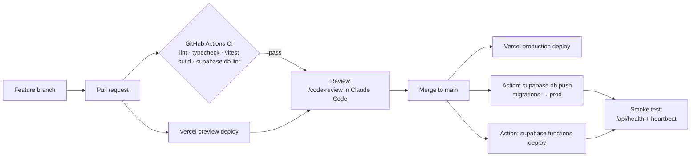

# Jobbbs — Tech Stack and Deployment

| | |
|---|---|
| **Status** | Draft v1.0 — planning |
| **Date** | 22 Oct 2026 |
| **Related** | [System design](02-system-design.md) · [Decision log](08-decision-log.md) |

Free-tier numbers below were checked in October 2026 from provider docs and recent third-party summaries. Free tiers change: re-check each provider's pricing page during Phase 0 and record anything different in the [decision log](08-decision-log.md).

---

## 1. The stack

| Layer | Choice | Why this | Alternatives considered |
|---|---|---|---|
| Language | **TypeScript (strict)** everywhere | One language for UI, API, workers and scoring; shared types | — |
| Repo | **pnpm workspaces**: `apps/web`, `packages/core`, `supabase/` | Shared core library without a heavy monorepo tool | Turborepo (add later if builds get slow) |
| Web framework | **Next.js (App Router)**, current stable (16.x at time of writing) | Server components keep pages fast; public pages are server-rendered for SEO; Route Handlers and Server Actions remove the need for a separate API server | Remix/React Router, Astro + SPA |
| UI | **Tailwind CSS v4** + **shadcn/ui** (copied source, restyled) + Radix primitives | Accessible primitives we fully own and restyle, so it won't look like default shadcn | MUI, Mantine (harder to make distinctive) |
| Icons | **Phosphor Icons** | More character than Lucide (which every AI-generated UI uses); has weight variants | Lucide, Tabler |
| Fonts | **Hanken Grotesk** (UI) + **JetBrains Mono** (numbers, times) via `next/font` | Distinct, legible, free; mono gives tabular scores and timestamps | Inter (overused), Geist |
| Forms and validation | **React Hook Form + Zod** | Zod schemas shared between client, server and adapters | Conform |
| Database | **Supabase Postgres** with `pgvector`, `pg_trgm`, `unaccent`, `pg_cron`, `pg_net`, `pgmq` | One managed Postgres covers search, vectors, queues and scheduling | Neon + separate queue/cron |
| DB access | **supabase-js** + generated types (`supabase gen types`) + SQL functions (RPC) for complex queries | Fewest moving parts; RLS-aware | Drizzle ORM (revisit if SQL gets unwieldy) |
| Auth | **Supabase Auth**: Google OAuth + email one-time code | Free up to 50k MAU; RLS integrates with `auth.uid()` | Clerk, Auth.js |
| File storage | **Supabase Storage** (private bucket) | Same policies model as tables | Cloudflare R2 |
| Background jobs | **Supabase Cron + Edge Functions + Queues** | Runs every 60 s on the free plan, next to the data. See §2. | Vercel Cron, GitHub Actions, Cloudflare Workers |
| Embeddings | **Supabase built-in `gte-small`** (384-d) inside Edge Functions | No API key, no per-call cost | OpenAI / Voyage embeddings (paid) |
| AI (Apply Kit) | **Gemini API free tier** via `@google/genai`, behind an `LlmProvider` interface, on demand only | ₹0 for personal use; one env var switches provider | Claude Opus 5.5 (paid, higher quality) |
| Resume parsing | **unpdf** (PDF) + **mammoth** (DOCX) | Run in Node and edge runtimes | pdf-parse |
| Search | **Postgres FTS + pg_trgm** | Enough for ≤200k active jobs; no extra service | Typesense / Meilisearch later |
| Alerts (personal edition) | **Resend**, test sender `onboarding@resend.dev` → your own address | Works with **no domain** when sending to your Resend account's email; HTTP API works from Edge Functions | Gmail SMTP (Supabase Edge Functions don't allow outbound connections on ports 25 and 587) |
| Instant alerts (public edition) | **Telegram Bot API** + **Web Push** (VAPID, `web-push`) | Free, instant, widely used in India | WhatsApp (paid per message) |
| Email (public edition) | **Resend** from your own verified domain (transactional + digests) | Simple API, React Email templates | Brevo (300/day free, adds its logo), Amazon SES (cheapest paid) |
| Web hosting | **Vercel Hobby** (Mumbai `bom1` functions) | Best Next.js support, preview deploys per PR | Cloudflare Workers via OpenNext (exit path) |
| Errors | **Sentry** (free developer plan) | Next.js + Deno SDKs | — |
| Product analytics | **PostHog Cloud** (free tier) | Funnels, feature flags, session replay off by default | Umami |
| Uptime and heartbeat | **healthchecks.io** (cron heartbeat) + **UptimeRobot** (HTTP) | Alerts us if ingest stops | Better Stack |
| Testing | **Vitest** (unit), **Playwright** (E2E), **pgTAP** via `supabase test db` (RLS) | Covers logic, flows and security | — |
| CI/CD | **GitHub Actions** (CI only) + Vercel Git integration | Free for CI minutes on private repos (2,000/mo) | — |
| Runtime | **Node.js 22 LTS** or newer; **pnpm 9+** | — | — |

## 2. Why background work runs on Supabase

The engine needs to run **every minute**, for **tens of seconds**, making **hundreds of HTTP calls**:

| Option | Fit for Jobbbs | Verdict |
|---|---|---|
| Vercel Cron (Hobby) | Minimum interval is once per day, with ±59 min precision | ✗ |
| Cloudflare Workers (free) | 10 ms CPU per invocation, 50 external subrequests, 5 cron triggers | ✗ too tight |
| GitHub Actions schedule | 5-minute minimum, frequent delays under load; Actions are meant for CI/CD of the repo itself | ✗ for production polling (✓ for CI and backups) |
| Oracle Cloud Always-Free VM | Generous, but you run a server: OS patches, Docker, idle-reclaim rules | Later option |
| **Supabase Cron + Edge Functions** | pg_cron supports every-minute (even sub-minute) schedules; Edge Functions allow 150 s wall time and 2 s CPU (I/O wait doesn't count); 500k invocations/month free | ✓ **chosen** |

The risk is **lock-in**. We contain it by keeping all logic in `packages/core` (pure TypeScript). Moving the engine to a container later only changes the thin runner.

## 3. Free-tier budget

**Personal edition (now):** with one user, user-driven quotas (auth, egress, Vercel calls, email) stay near zero. The engine's footprint depends on **how many company boards you poll**, not on users. 1,500 boards uses about 60% of the free database and 22% of Edge Function calls; 300–600 boards is a comfortable start. Your email alerts are capped at 80/day, inside Resend's 100/day. There's no running cost: the Apply Kit uses Gemini's free tier (ADR-016).

**Public edition (later):** the table below estimates usage at 1,000 users.

| Service | Free allowance (Oct 2026) | Estimated use at 1,000 users / 300 DAU | Status |
|---|---|---|---|
| Supabase DB size | 500 MB | ~300 MB | OK (watch) |
| Supabase egress | 5 GB/mo | ~2 GB | OK |
| Supabase Edge Function invocations | 500k/mo | ~110k | OK |
| Supabase Storage | 1 GB | under 50 MB (parse-and-discard default) | OK |
| Supabase Auth | 50k MAU | 1k | OK |
| Vercel Hobby functions | 1M invocations/mo, 4 active CPU-hours, 100 GB transfer | ~270k invocations | OK |
| Resend | 3,000 emails/mo, 100/day | ~4,600/mo | **Over at ~600 users** |
| Telegram Bot API | No fee (rate limits only) | — | OK |
| Web Push | No fee | — | OK |
| PostHog | 1M events/mo | ~450k | OK |
| Sentry | Developer plan quota | low | OK |
| GitHub Actions | 2,000 min/mo (private repo) | ~600 min (CI) | OK |

**Important constraints**

- **Vercel Hobby is non-commercial.** It's fine while Jobbbs is free with no ads or payments. Before charging money or showing ads, move to Vercel Pro ($20/mo) or Cloudflare Workers paid ($5/mo) with OpenNext. Decision **D5**.
- **Supabase free projects pause after about a week of inactivity**, and the free plan has no automatic backups. Our per-minute cron keeps the project active, and a nightly GitHub Action takes a `pg_dump` of user tables (encrypted) as a backup.
- **Email without a domain only reaches you.** Resend's test sender delivers only to the email on your Resend account; that's all the personal edition needs (D4, ADR-014). Emailing other people needs your own verified domain (SPF/DKIM), which is part of the Go-public phase.

## 4. Cost by stage

| Stage | Users | Monthly cost | What changes |
|---|---|---|---|
| **Personal edition** | 1 (you) | **₹0** | Everything on free tiers, including Gemini; no domain |
| **0 — Public alpha** | under 600 | **₹0** + domain ≈ ₹800–1,200/year | Everything on free tiers; email digests capped. One Gemini free quota is shared by everyone, so plan a paid AI tier |
| **1 — Beta** | 600–5,000 | ≈ ₹500–2,500 | Email via Amazon SES (~$0.10/1k) or Resend Pro ($20); Apply Kit AI usage (see below) |
| **2 — Growth** | 5,000–50,000 | ≈ ₹6,000–12,000 | Supabase Pro ($25); Vercel Pro ($20) or Cloudflare ($5); ingest worker on a small VPS (~€5); more AI usage |

**AI cost per Apply Kit** (≈4k input + 1.5k output tokens):

| Provider / model | Price | Per kit | 1,000 kits/month |
|---|---|---|---|
| **Gemini free tier, Flash model (default, ADR-016)** | Free within the daily quota shown in AI Studio | $0 | $0 while within quota |
| `claude-opus-5-5` (optional) | $4 / $20 per 1M tokens | ≈ $0.05 | ≈ $50 |
| `claude-haiku-5-5` (optional) | $0.10 / $0.50 per 1M tokens | ≈ $0.0013 | ≈ $1.30 |

Job-level caching cuts these numbers further, because one job's summary is shared by everyone who opens it. **Decision D3 (revised): Gemini free tier.** Free quotas are set per project and change over time, so check AI Studio and set `AI_DAILY_REQUEST_LIMIT` below the shown quota. On the free tier Google may use prompts to improve its products, hence the data rule in ADR-016. Claude stays one env var away; its API is billed separately from a Claude Code subscription.

## 5. Environments

| Environment | Web | Database | Purpose |
|---|---|---|---|
| **Local** | `pnpm dev` (localhost:3000) | `supabase start` (Docker) | Development; seed data; Edge Functions with `supabase functions serve` |
| **Preview** | Vercel preview per PR | Shared **dev** Supabase project | Review UI changes |
| **Production** | Vercel production (`jobbbs.vercel.app`, then your domain) | **prod** Supabase project (Mumbai) | Real users |

The free plan allows two active projects, which covers dev and prod.

### Environment variables

| Name | Where | Secret? |
|---|---|---|
| `NEXT_PUBLIC_SUPABASE_URL`, `NEXT_PUBLIC_SUPABASE_ANON_KEY` | Vercel, local | No (public by design; RLS protects data) |
| `SUPABASE_SERVICE_ROLE_KEY` | Vercel (server only), Supabase function secrets | **Yes** |
| `GEMINI_API_KEY` | Vercel (server only) | **Yes** |
| `ANTHROPIC_API_KEY` *(only if `AI_PROVIDER=anthropic`)* | Vercel (server only) | **Yes** |
| `AI_PROVIDER=gemini`, `AI_MODEL=<free Flash model from AI Studio>`, `AI_DAILY_REQUEST_LIMIT` | Vercel | No |
| `RESEND_API_KEY` | Supabase function secrets | **Yes** |
| `EMAIL_FROM=onboarding@resend.dev`, `ALERT_EMAIL_TO=<your Resend account email>` | Supabase function secrets | No |
| `TELEGRAM_BOT_TOKEN`, `TELEGRAM_WEBHOOK_SECRET` *(Go-public)* | Supabase function secrets, Vercel | **Yes** |
| `VAPID_PUBLIC_KEY` (`NEXT_PUBLIC_…`), `VAPID_PRIVATE_KEY` *(Go-public)* | Vercel, Supabase secrets | Private key **yes** |
| `ADZUNA_APP_ID`, `ADZUNA_APP_KEY`, `JOOBLE_API_KEY` | Supabase secrets | **Yes** |
| `HEALTHCHECKS_PING_URL` | Supabase secrets | Yes |
| `SENTRY_DSN`, `NEXT_PUBLIC_POSTHOG_KEY` | Vercel, Supabase | No |
| `CRON_SHARED_SECRET` | Supabase Vault (read by cron SQL) + function secrets | **Yes** |

Commit an `.env.example` with names only. Real values live in Vercel and Supabase secret settings, never in Git.

## 6. Delivery pipeline



**Rules:**
- Migrations are forward-only SQL files in `supabase/migrations/`, created with `supabase migration new`. Never edit an applied migration.
- Deploy migrations **before** code that depends on them, with expand → migrate → contract for breaking changes.
- Playwright E2E runs nightly against the preview/dev environment, not on every PR, to save CI minutes.

## 7. Local setup (after Phase 0 scaffolding)

```bash
# prerequisites: Node 22+, pnpm, Docker Desktop, Supabase CLI, Git
pnpm install
supabase start                      # local Postgres, Auth, Storage, Studio
supabase db reset                   # apply migrations + seed.sql
pnpm --filter web dev               # http://localhost:3000
supabase functions serve            # Edge Functions locally
pnpm test                           # vitest across packages
```

## 8. Exit paths (portability)

| If… | Move to | Effort |
|---|---|---|
| We start charging money | Vercel Pro, or Cloudflare Workers paid + OpenNext | Low (no Vercel-only APIs used) |
| DB or egress limits are hit | Supabase Pro | None (plan change) |
| Polling outgrows Edge Functions | Node worker in a container (Fly.io, Railway, Hetzner) reading `pgmq` | Low: same `packages/core`, new runner |
| FTS gets slow (over 200k active jobs) | Typesense or Meilisearch, synced from `job_events` | Medium |
| Email volume grows | Amazon SES | Low (provider interface) |

## 9. Production readiness checklist

- [ ] GitHub repo private; branch protection on `main`; secret scanning on
- [ ] Two Supabase projects (dev, prod) in Mumbai; migrations apply cleanly from zero
- [ ] RLS enabled and explicit grants on every table; pgTAP RLS tests green
- [ ] No service-role key in any client bundle (checked with a build-output grep in CI)
- [ ] Cron jobs created; heartbeat monitor alerting to your phone
- [ ] One source adapter verified against a real endpoint and logged in `ingest_runs`
- [ ] Personal edition: sign-ups turned off after the owner account exists; alert email reaches your phone
- [ ] *Go-public:* Telegram bot webhook set with a secret token; `/start` linking tested
- [ ] *Go-public:* Web Push tested on Android Chrome and iOS (installed PWA)
- [ ] *Go-public:* email domain verified in Resend; unsubscribe link in every digest
- [ ] *Go-public:* privacy policy, terms, "How we get jobs" page, grievance contact
- [ ] Nightly backup Action running; restore tested once
- [ ] Sentry receiving errors from web and functions; PostHog events flowing
- [ ] Quotas dashboard reviewed (DB size, egress, invocations, emails)
