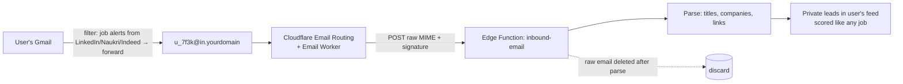

# Jobbbs — Data Sources and Compliance

| | |
|---|---|
| **Status** | Draft v1.0 — planning. Every endpoint must be re-verified (docs + terms) before its adapter ships. |
| **Date** | 22 Oct 2026 |
| **Related** | [System design §2](02-system-design.md#2-ingestion-engine) · [Decision log](08-decision-log.md) (D1) |

---

## 1. Strategy: four channels, no scraping of the big boards

You asked for integration with LinkedIn, Naukri, Indeed and others. None of those three offers an open job-search API to independent developers, and their terms prohibit automated scraping. LinkedIn in particular has a history of litigation over it. A product built on scraping them could be blocked or shut down at any time.

The good news: **the freshest data isn't on those sites anyway.** It's on the employers' own career boards. So Jobbbs gets jobs through four legitimate channels:

| # | Channel | What it gives us | Speed | Coverage | Phase |
|---|---|---|---|---|---|
| 1 | **Direct ATS boards**: public JSON that companies publish for their careers pages | The original posting, apply link on the employer's site | ★★★ minutes | Companies on those ATSs | 1 |
| 2 | **Aggregator APIs** with official keys (Adzuna, Jooble) and public remote-job feeds | Breadth: many employers, including ones we don't poll directly | ★ hours | Broad | 2 |
| 3 | **Smart Links**: pre-filled searches on LinkedIn, Naukri, Indeed, Wellfound… filtered to the last hour | The user checks those platforms in one click, at exactly the right moment | ★★ user-driven | Everything those sites have | 5 |
| 4 | **Forwarded alert emails**: the user forwards their own LinkedIn/Naukri/Indeed job-alert emails to a personal Jobbbs address | Those platforms' jobs, scored and merged into the user's private feed | ★★ when the email arrives | What the user's alerts cover | 7 |

> **Decision D1 (confirmed 22 Oct 2026):** Jobbbs does not scrape LinkedIn, Naukri or Indeed, and never logs in as a user on any site. If you ever get official partner access to one of them, it becomes a fifth channel through the same adapter interface.

## 2. Source catalog

"Verify" means: read the current docs and terms, confirm the endpoint and rate limits, and record the result in the decision log before shipping the adapter.

### 2.1 ATS boards (channel 1)

| Source | Public endpoint (verify) | Notes |
|---|---|---|
| **Greenhouse** | `GET https://boards-api.greenhouse.io/v1/boards/{token}/jobs` (list); `…/jobs/{id}?questions=true` (detail with application questions) | Documented Job Board API, no auth for GET. List without `content=true` is small; fetch detail only for new jobs. No pay range or employment type in the board API. |
| **Lever** | `GET https://api.lever.co/v0/postings/{company}?mode=json` | Public postings API; includes `createdAt`, categories, description. |
| **Ashby** | `GET https://api.ashbyhq.com/posting-api/job-board/{name}?includeCompensation=true` | Public posting API; structured compensation when the employer opts in. Terms are written for companies' own careers pages, so treat third-party use as permitted but not explicitly licensed and respect any request to stop. |
| **Workable** | `GET https://apply.workable.com/api/v1/widget/accounts/{subdomain}` | Widget API used by careers pages. Phase 7. |
| **SmartRecruiters** | `GET https://api.smartrecruiters.com/v1/companies/{id}/postings` | Public Posting API. Phase 7. |
| **Recruitee** | `GET https://{company}.recruitee.com/api/offers/` | Careers-site API. Phase 7. |
| **Keka, Darwinbox, Zoho Recruit, Freshteam** (India-heavy) | Careers pages per company | High value for India coverage. Each needs a terms review and a check that a public, unauthenticated JSON endpoint is intended for careers pages. Phase 7, case by case. |
| **Workday** | Per-tenant careers sites | Used by many large employers in India. Endpoints are internal to Workday career sites, not a documented public API. Only after a careful terms review; possibly never. |

### 2.2 Aggregators and feeds (channel 2)

| Source | Endpoint / access | Notes |
|---|---|---|
| **Adzuna** (India: `/v1/api/jobs/in/search/{page}`) | Free API key | Reported free quota is about 1,000 calls/month, so use it for breadth through about 25 well-chosen daily queries. Descriptions are truncated; salaries may be predicted (`salary_is_predicted`), and we label them that way. |
| **Jooble** | API key on request | India coverage; check quota and attribution rules. |
| **Remotive** | `https://remotive.com/api/remote-jobs` | Remote roles. Respect their stated rate limits and attribution; some free feeds are delayed, so this is for coverage, not speed. |
| **Arbeitnow** | `https://www.arbeitnow.com/api/job-board-api` | Mostly Europe + remote. |
| **RemoteOK** | `https://remoteok.com/api` | Requires a link back and attribution. |
| **Himalayas** | `https://himalayas.app/jobs/api` | Remote roles with structured data. |
| **Hacker News "Who is hiring"** | Algolia HN API | Monthly thread; parse with care. Phase 7. |

## 3. Building the company list

The engine is only as good as its list of boards. We grow it in four ways:

1. **Seed list (Phase 0–1).** About 500 Indian tech employers plus about 1,000 global remote-friendly companies, compiled by hand from public sources (startup directories, company careers pages).
2. **ATS detector** (`scripts/ats-detect.ts`). Given a careers URL, it follows redirects and matches known patterns to find the board token:

| ATS | URL pattern → token |
|---|---|
| Greenhouse | `boards.greenhouse.io/{token}`, `job-boards.greenhouse.io/{token}`, embed `?for={token}` |
| Lever | `jobs.lever.co/{token}` |
| Ashby | `jobs.ashbyhq.com/{token}` |
| Workable | `apply.workable.com/{token}` |
| SmartRecruiters | `jobs.smartrecruiters.com/{token}` |
| Recruitee | `{token}.recruitee.com` |
| Keka | `{token}.keka.com/careers` |
| Darwinbox | `{token}.darwinbox.in/ms/candidate/careers` |
| Zoho Recruit | `{token}.zohorecruit.in/jobs/Careers` |

3. **User requests.** A user who follows a company we don't poll yet can paste its careers URL. The detector finds the ATS and the board joins Tier A after an admin approval queue (auto-approve later).
4. **Discovery from aggregators.** When an Adzuna or Jooble job redirects to a Greenhouse/Lever/Ashby URL, we learn that company's board and start polling it directly. Coverage grows by itself.

## 4. Polling etiquette

- Identify ourselves: `User-Agent: JobbbsBot/1.0 (+https://<domain>/bot)`, with a page explaining what we fetch and how to opt out.
- At most 1 request/second per host, with jitter; global concurrency of 10 per tick.
- Use `ETag` / `If-None-Match` and `If-Modified-Since` where supported.
- Honor `429` and `Retry-After`; back off exponentially on errors.
- For any non-API page: respect `robots.txt`. We never fetch pages behind a login.
- Honor opt-out requests from employers or providers within 24 hours (board `enabled = false`, with a note).

## 5. Smart Links

Generated per saved search. Parameters are URL-encoded; **verify each template in Phase 5**, because platforms change their URLs.

| Platform | Template | Recency filter |
|---|---|---|
| LinkedIn | `https://www.linkedin.com/jobs/search/?keywords={q}&location={loc}&f_TPR=r3600&sortBy=DD` | `f_TPR=r3600` = last hour (seconds) |
| Naukri | `https://www.naukri.com/{q-slug}-jobs-in-{city-slug}?jobAge=1` | `jobAge=1` = last day |
| Indeed India | `https://in.indeed.com/jobs?q={q}&l={loc}&fromage=1&sort=date` | `fromage=1` = last day |
| Wellfound | `https://wellfound.com/jobs?…` | Role + location filters |
| Google Jobs | `https://www.google.com/search?q={q}+jobs+{loc}&ibp=htl;jobs` | Use "date posted" chip |

These are plain links. Jobbbs never fetches the results, so no terms are crossed. Telegram alerts can include a "Check LinkedIn (last hour)" link next to the Jobbbs result.

## 6. Forwarded alert emails (Phase 7)

- The user's own data, sent by the user. It needs a domain on Cloudflare DNS (decision D4).
- Jobs from forwarded emails stay **private to that user** and are not added to the shared feed.
- Gmail asks the user to confirm the forwarding address; our function auto-handles that confirmation email.

## 7. What we show, and how

| Rule | Why |
|---|---|
| Every job links to the original posting and apply page, with the source name visible | Attribution; the employer gets the application |
| Public (logged-out) job pages show title, company, location, salary, skills and a ~300-character excerpt + "View original" | Limits republication of full descriptions; still good for SEO |
| Signed-in users see the full description, attributed, for scoring and the Apply Kit | Needed to explain the match |
| We show `posted_at` only when the source provides it. Otherwise only "Detected by Jobbbs at …" | Never imply a job is newer than it is |
| We never show or estimate applicant counts | We can't know them |
| Predicted salaries (Adzuna) are labelled "Estimated by Adzuna" | Honesty |
| No `JobPosting` structured data on public pages at launch | Avoid presenting third-party jobs as our own to search engines; revisit with legal advice |

## 8. Privacy and legal checklist (India DPDP Act 2023 / Rules 2025)

The DPDP Rules were notified in November 2025 and phase in over about 18 months; core obligations apply from about May 2027. Jobbbs builds to them from day one:

- [ ] **Notice** at sign-up in plain language: what we collect (profile, resume, preferences, activity), why, how long, and who processes it (Supabase, Vercel, Resend, Telegram, and Google Gemini or Anthropic for AI features). Public users' data must not go to a free AI tier whose terms allow training on it (ADR-016).
- [ ] **Consent**: separate opt-ins for alerts per channel and for AI processing of the resume (the AI section is off until consented).
- [ ] **Purpose limitation**: no selling data, no ads based on resumes.
- [ ] **Data rights**: export (JSON) and delete (within 24 h) from Settings.
- [ ] **Retention**: resume file not stored by default; closed jobs pruned after 30 days; ingest logs after 14 days; notifications after 90 days.
- [ ] **Security**: RLS, encryption at rest (provider), least-privilege keys, breach-response runbook (inform affected users and the Data Protection Board as the Rules require).
- [ ] **Grievance contact**: a named contact email on the privacy page.
- [ ] **Children**: Jobbbs is for users 18 and over (stated at sign-up).
- [ ] **Terms of use** and a **"How we get jobs"** page explaining channels 1–4 and the opt-out process for employers.

> This is a product checklist, not legal advice. Get a short review from a lawyer before public launch, especially for §2.1 sources and §7 display rules.
