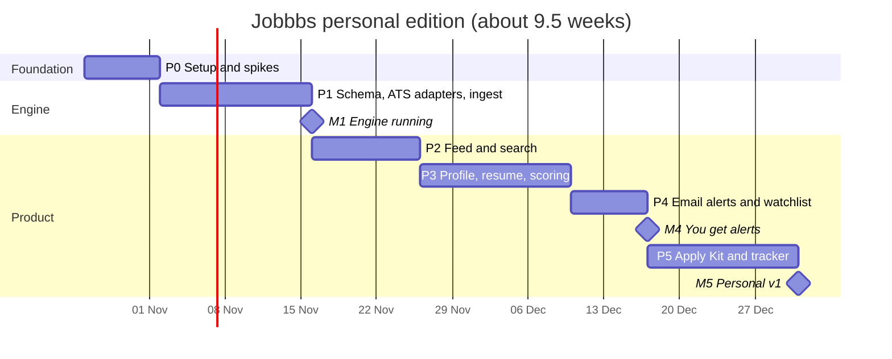

# Jobbbs — Roadmap

| | |
|---|---|
| **Status** | v1.1 — updated for the personal edition (ADR-013) |
| **Date** | 22 Oct 2026 |
| **Assumption** | One developer, about 15–20 focused hours a week, working with Claude Code. Full-time roughly halves the calendar. |

---

## 1. Two releases

| Release | For | Alerts | When |
|---|---|---|---|
| **Personal edition (v1)** | You only (sign-ups closed) | Email to yourself via Resend, no domain | Phases 0–5, target **30 Dec 2026** |
| **Public edition** | Invited users, then anyone | Telegram + Web Push + email from your own domain | **Go-public** phase, when you decide |

The database, security rules and code structure are multi-user from day one, so going public adds features without rewriting anything.

**Execution:** this roadmap is broken into deployable tasks in [10-task-tracker.md](10-task-tracker.md) (T01–T39), with feature status in [09-feature-tracker.md](09-feature-tracker.md). Phase mapping: P0 = T01–T03 · P1 = T04–T10 · P2 = T11–T14 · P3 = T15–T19 · P4 = T20–T23 · P5 = T24–T27. The design foundation (T04) moved forward into P1 so the admin page and feed share it.

## 2. Timeline (personal edition)

| Milestone | Date (planned) | What's true when we reach it |
|---|---|---|
| **M1 — Engine running** | 15 Nov 2026 | Your target companies' boards polled on schedule; jobs de-duplicated; health and detection-latency page works |
| **M2 — Feed** | 25 Nov 2026 | You can browse and filter real, fresh jobs on laptop and phone |
| **M3 — Scored feed** | 9 Dec 2026 | Every job shows an explained score against your profile |
| **M4 — You get alerts** | 16 Dec 2026 | Matching jobs arrive in your inbox within minutes of detection |
| **M5 — Personal v1** | 30 Dec 2026 | Full loop: detect → score → email → Apply Kit → tracker |

## 3. Phases

Each phase lists what to build, the tests that prove it, and its **Definition of Done (DoD)**. Work in small vertical slices, one pull request per slice.

### Phase 0 — Setup and spikes (26 Oct – 1 Nov)

**Build**
- GitHub repo (private), pnpm workspace, Next.js app, `packages/core`, Supabase CLI project; `CLAUDE.md` and `.claude/` from the [playbook](07-claude-code-playbook.md).
- Two Supabase projects (dev, prod) in **Mumbai**; Vercel project linked (functions region `bom1`).
- CI: lint, typecheck, vitest, build.
- Google sign-in working on the deployed `*.vercel.app` URL. Create your account, then **turn off new sign-ups** in Supabase Auth.
- Resend account created with the email address you want alerts at; Gemini API key from Google AI Studio (free).

**Spikes**, each a time-boxed experiment with its result written into the [decision log](08-decision-log.md):

| Spike | Question | Pass condition |
|---|---|---|
| S1 | Can one Edge Function invocation poll 150 Greenhouse/Lever boards? | < 60 s wall time, < 2 s CPU |
| S2 | Can `packages/core` be imported by both Next.js and Deno Edge Functions? | Same scoring test passes in both. Fallback: bundle core with esbuild into `supabase/functions/_shared/core.js` at deploy. |
| S3 | Does Supabase Cron → pg_net → Edge Function run reliably every minute? | 24 h with no gaps; heartbeat green |
| S4 | Does an email from an Edge Function via Resend's test sender reach your phone quickly? | Gmail filter + label notification fires within 1 minute |
| S5 | Which ATS endpoints and terms hold up today? | Greenhouse, Lever, Ashby verified and recorded |
| S6 | Which of *your* target companies use a public-board ATS? | ATS detector run on your list (start with 100–300 companies); result recorded |

**DoD:** the deployed app signs you in (and nobody else); all six spikes have recorded results.

### Phase 1 — Job engine (2 – 15 Nov)

**Build**
- Migrations: `companies`, `boards`, `jobs`, `job_tombstones`, `skills`, `job_skills`, `ingest_runs`; queues `job_events`, `notify`; `claim_due_boards()`.
- Adapters: **Greenhouse, Lever, Ashby**, each with recorded fixtures and contract tests.
- Normalizers: India location, salary (LPA/INR/USD), experience, title and seniority.
- De-duplication: fingerprint + fuzzy cluster; canonical selection.
- `ingest-tick`: tiers, leases, ETag, backoff, write-light polling, lifecycle (missing → closed), repost detection.
- `maintenance`: pruning, re-tiering, DB-size check, heartbeat.
- Seed: your target companies first (Tier A), then a broader India tech list (Tier B/C) via `scripts/ats-detect.ts`.
- Admin page: Source health (polls, success %, last error, new jobs/day, detection latency p50/p95).

**Tests:** fixtures for every adapter (valid, empty, malformed, 429, 5xx, timeout); normalizer tables (50+ real Indian salary and location strings); dedupe cases; lifecycle transitions.

**DoD:** 72-hour soak with ≥ 98% successful polls; no duplicate canonical jobs in a manual sample of 100; first real detection-latency numbers.

### Phase 2 — Feed and search (16 – 25 Nov)

**Build**
- Aggregator adapters: **Adzuna (India)**, plus **Remotive, Arbeitnow, RemoteOK, Himalayas** if you want remote roles; Jooble if a key arrives.
- `/dev/ui` component sheet (JobRow, ScoreRing, FreshnessPill, chips), then the three-pane feed, job detail, filters (URL state), sorting, keyset pagination, keyboard navigation.
- Full-text + trigram search; "N new" Realtime banner.

**Deferred to Go-public:** landing page, public job pages, "How we get jobs" page.

**Tests:** filter combination tests (SQL); Playwright: search → filter → open job → apply link; Lighthouse ≥ 90 for performance and accessibility on the feed.

**DoD:** you can find relevant, fresh jobs on your phone in under 30 seconds.

### Phase 3 — Profile and matching (26 Nov – 9 Dec)

**Build**
- Profile editor (single page, no wizard): resume upload and parsing (unpdf, mammoth) → skills, years, titles; you confirm and edit. "Parse and discard" default.
- Skills taxonomy v1: about 1,500 tech skills with aliases and parents (React ↔ React.js ↔ ReactJS; Next.js → React).
- `pipeline` enrichment: skill extraction, experience and salary parsing, `gte-small` embeddings.
- Scoring engine in `packages/core/scoring` + breakdown UI + weights sliders + dealbreakers; sorts *Best match* and *Apply first*.

**Tests:** 30+ golden scoring cases (profile + job → expected score ±2); unknown-handling cases; scorer speed < 1 ms per job.

**DoD:** every score in the UI explains itself factor by factor, and your top 10 matches look right to you.

### Phase 4 — Email alerts and watchlist (10 – 16 Dec)

**Build**
- Saved searches (from current filters, one click) and watchlist (follow a company; add a new one by careers URL).
- `pipeline`: candidate prefilter → score → notifications with idempotency keys.
- **Email to you** via Resend's test sender (ADR-014): one email per batch of new matches, 5-minute bundling, 80/day cap with hourly-digest fallback, quiet hours, optional daily summary.
- Each email: score, title, company, location, freshness, **Apply on company site** link, "Open in Jobbbs" link, and **Smart Links** ("LinkedIn, last hour" / "Naukri, last day") for the same search.
- Thumbs up/down links in the email and the app (relevance feedback).

**Tests:** idempotency (replay the same events 10×, expect exactly one email); bundling and daily cap; quiet hours; end-to-end latency measurement.

**DoD:** p95 detection → email under 5 min across a 7-day soak; zero duplicates.

### Phase 5 — Apply Kit and tracker (17 – 30 Dec)

**Build**
- Rule-based Apply Kit: at-a-glance, fit, must-have vs nice-to-have, missing keywords, Greenhouse application questions, referral and recruiter search links, timeline.
- AI section via the **Gemini free tier** (ADR-016) behind a daily request guard (`ai_usage`), streamed from `/api/jobs/[id]/apply-kit`, cached per job. Only job text + skills/years/target titles are sent.
- Smart Links panel on each saved search.
- Tracker: kanban, notes, follow-up reminders (by email).

**Tests:** kit renders with and without AI; daily request limit enforced; Smart Link templates checked by hand on each platform.

**DoD:** you go from alert email to applied in under 2 minutes.

### After v1 — Use it and tune (January 2027, ongoing)

Use Jobbbs daily for 2–4 weeks before adding big features:
- Tune score weights, skill aliases and the minimum score from your thumbs-up/down data.
- Add companies you discover; promote busy ones to Tier A.
- Add adapters where your targets are: Workable, SmartRecruiters, Recruitee; Keka, Darwinbox, Zoho Recruit after terms review.
- Run `/security-review` once, even for personal use: auth settings, RLS, secrets.

### Go public — when you decide (about 3–4 weeks)

| Area | Work |
|---|---|
| Domain and email | Buy a domain (≈ ₹800–1,200/year); verify it in Resend (SPF/DKIM); send from `alerts@yourdomain` |
| Channels | Telegram bot and Web Push (ADR-008) |
| Onboarding | Sign-ups on; onboarding wizard (resume → confirm → preferences → first alert) |
| Public pages | Landing page with live ticker, public job pages (excerpt + source link), "How we get jobs" |
| Privacy and legal | Privacy policy, terms, consent screens, data export and delete, grievance contact (DPDP; see [04 §8](04-data-sources-and-compliance.md#8-privacy-and-legal-checklist-india-dpdp-act-2023--rules-2025)) |
| Hardening | pgTAP RLS tests for every owner-only table, rate limits, CSP headers, Sentry, PostHog, uptime monitors, nightly backups + one restore test, accessibility pass |
| Capacity | Review the [free-tier budget](03-tech-stack-and-deployment.md#3-free-tier-budget); email becomes the first paid item at about 600 users |

**DoD:** the [production readiness checklist](03-tech-stack-and-deployment.md#9-production-readiness-checklist) is fully ticked.

### Later — growth ideas (ordered by expected value)

1. Alert-email forwarding from LinkedIn/Naukri/Indeed (needs the domain on Cloudflare).
2. Company pages (open roles, hiring velocity).
3. Weight suggestions from feedback; "jobs like this".
4. "Send to Jobbbs" browser button (user-initiated only).
5. Paid plan, only if you change D5.

## 4. Working rhythm

- **Weekly:** pick the slices for the week, ship them behind flags, check the admin metrics (sources, latency, quotas).
- **Per slice:** plan (Claude Code plan mode) → build → tests → `/code-review` → merge → update docs if a decision changed.
- **Per phase:** use it on your phone, tick the DoD, record learnings in the decision log.

## 5. Risks to the schedule

| Risk | Likelihood | Mitigation |
|---|---|---|
| Few of your target companies use a public-board ATS | Medium | Measured in S6; aggregators add breadth; Smart Links in every email cover the big boards |
| Endpoint or terms changes at a source | Medium | Adapter isolation, Zod validation, auto-disable on parse errors |
| Alert emails land in spam or Promotions | Medium | Gmail filter on the sender (S4); plain-text-first email template |
| Free-tier limits change | Low (single user) | Portable core; documented exit paths |
| Scope creep (public features before v1) | High | Everything public-facing waits for the Go-public phase |
